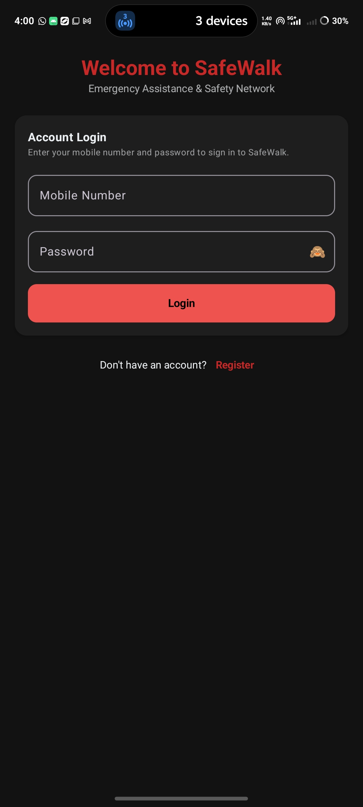
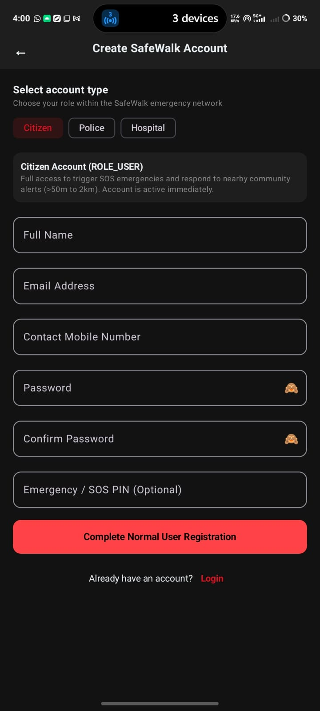
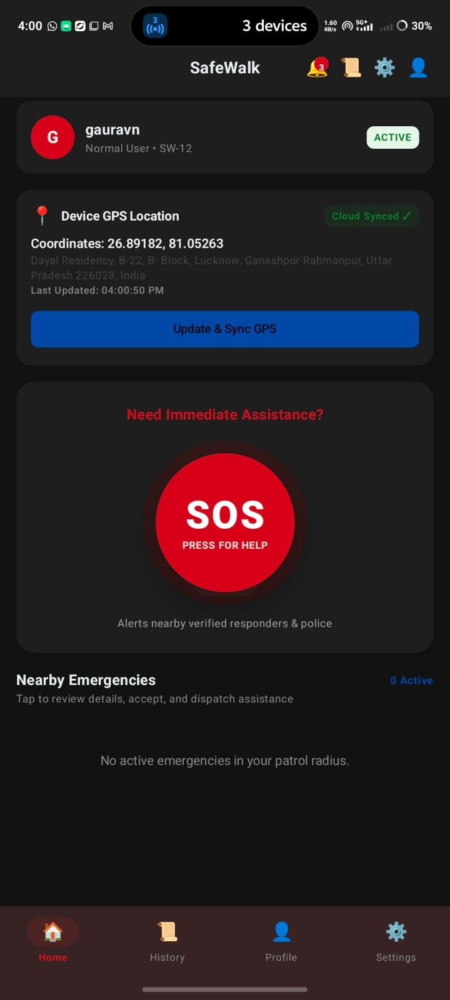
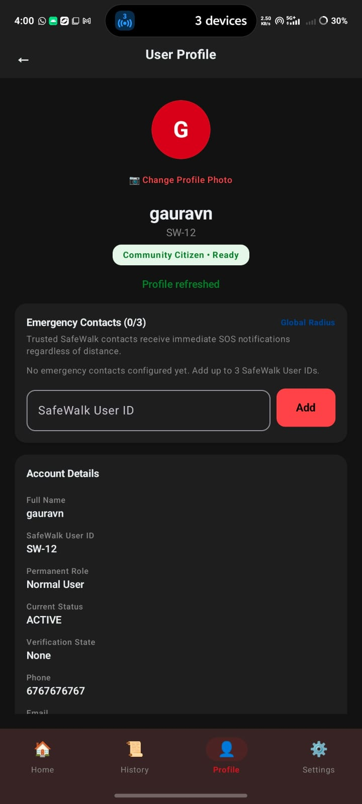
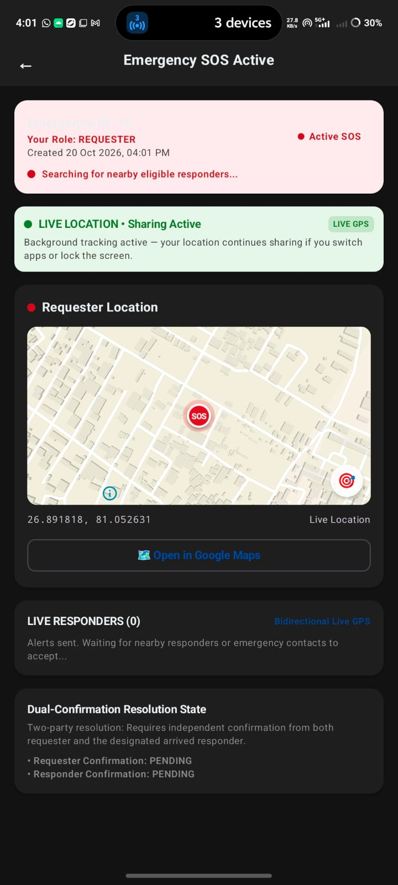
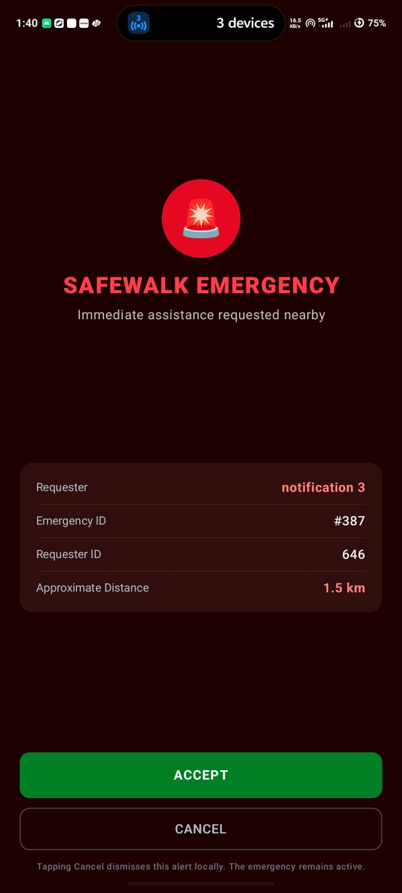

# SafeWalk Android — Real-Time Emergency Assistance & Community Safety Network

[-3DDC84?logo=android&logoColor=white)](https://developer.android.com)
[](https://kotlinlang.org)
[](https://developer.android.com/jetpack/compose)
[](https://gradle.org)
[](https://github.com/gauravto312-wq/SafeWalk-Android/releases/tag/v1.0.0)

SafeWalk is a native Android personal safety application designed to bridge the critical response gap during personal emergencies. Built with modern Android development standards—**Kotlin 2.2**, **Jetpack Compose (Material 3)**, **Clean Architecture**, and **MVVM**—the application coordinates immediate, localized emergency assistance by connecting distressed citizens with nearby verified community responders, designated emergency contacts, and emergency services.

---

### 📦 Quick Access & Download
* **Latest Release:** [SafeWalk v1.0.0 Release Notes](https://github.com/gauravto312-wq/SafeWalk-Android/releases/tag/v1.0.0)
* **Direct APK Download:** [📥 Download SafeWalk-v1.0.0.apk](https://github.com/gauravto312-wq/SafeWalk-Android/releases/download/v1.0.0/SafeWalk-v1.0.0.apk)


---

## Table of Contents
1. [Project Overview](#1-project-overview)
2. [End-to-End Demo Video](#2-end-to-end-demo-video)
3. [Application Screenshots](#3-application-screenshots)
4. [Key Features](#4-key-features)
5. [Technology Stack](#5-technology-stack)
6. [System Architecture](#6-system-architecture)
7. [Android Repository Structure](#7-android-repository-structure)
8. [Getting Started](#8-getting-started)
9. [APK Download & Installation](#9-apk-download--installation)
10. [Related Repositories](#10-related-repositories)
11. [Testing & Verification](#11-testing--verification)
12. [Security & Privacy](#12-security--privacy)
13. [Known Limitations & Future Improvements](#13-known-limitations--future-improvements)
14. [Contributing & License](#14-contributing--license)
15. [Author & Contact](#15-author--contact)

---

## 1. Project Overview

### The Problem
During personal safety crises, physical attacks, or medical emergencies, contacting traditional public dispatchers alone often introduces critical response latency. Victims may only have seconds to signal for help, and responders frequently lack live, continuous location tracking to reach the exact scene quickly. Furthermore, nearby capable citizens and trusted personal contacts often remain unaware of an emergency happening just hundreds of meters away.

### The SafeWalk Solution
SafeWalk creates an active, real-time safety network on the user's mobile device:
* **One-Tap SOS Initiation:** Activates high-priority emergency mode with a single tap, capturing precise GPS coordinates.
* **Continuous Background Location Sharing:** Launches an Android foreground service to stream live location coordinates continuously, even when the screen is locked or another app is open.
* **Geofenced Community Alerting:** Signals nearby active community responders within a configured patrol radius (>50m to 2km) via cloud spatial queries.
* **Global Radius Emergency Contacts:** Notifies up to three pre-configured personal contacts regardless of physical distance.
* **Dual-Confirmation Resolution:** Requires mutual verification from both the requester and the responding party to resolve an active emergency, preventing coerced cancellations.

### Role of the Android Application
The Android application acts as the real-time edge client in the SafeWalk ecosystem. It handles sensor data acquisition (fine/coarse GPS), encrypted session persistence, bidirectional STOMP-over-WebSocket event streaming, high-priority Firebase Cloud Messaging (FCM) alerts with full-screen lockscreen interruption, and interactive vector map rendering.

---

## 2. End-to-End Demo Video

Witness the real-world execution of SafeWalk, including account authentication, real-time GPS synchronization, profile inspection, one-tap SOS activation, interactive vector map rendering, and dual-confirmation status tracking.

### ▶ [Watch SafeWalk: Complete Android App Flow (YouTube)](https://youtu.be/91b0QSqxUSY)

*Direct Link: `https://youtu.be/91b0QSqxUSY` (Unlisted Walkthrough)*

```
[ SafeWalk Live App Demo ]
   │
   ├─► 1. Launch & Authentication (Mobile & Password Sign-in)
   ├─► 2. Home Dashboard & Device GPS Location Sync
   ├─► 3. User Profile & Emergency Contacts Configuration
   ├─► 4. One-Tap SOS Activation ("PRESS FOR HELP")
   └─► 5. Active SOS Dashboard (Live Vector Map, GPS Stream, Dual Resolution)
```

> **Note on Video Demonstration:** The demonstration video depicts actual runtime interactions against the deployed backend service on an Android device.

---

## 3. Application Screenshots

The following gallery illustrates the real user interface of SafeWalk. The UI is built entirely in declarative **Jetpack Compose** with a dark-mode emergency theme designed for rapid accessibility and high contrast during stress situations.

---

### 1. Login Screen

*Caption: Primary account sign-in interface featuring mobile number and password fields, secure password toggle, and direct navigation to registration.*

**Screen Description & Capabilities:**
* Clean authentication interface featuring dedicated fields for contact mobile number and password (with toggleable visibility).
* Direct entry point for registered users with immediate inline validation.
* Navigation link at the bottom enabling new users to access account creation.

---

### 2. Registration Screen

*Caption: Multi-role onboarding screen for Citizen, Police, and Hospital accounts, capturing full name, email, contact number, password, and optional SOS PIN.*

**Screen Description & Capabilities:**
* Multi-role account onboarding supporting **Citizen (`ROLE_USER`)**, **Police**, and **Hospital** accounts.
* Role-based policy explanations informing users of their emergency response capabilities (e.g., citizen alerts active within >50m to 2km).
* Collects Full Name, Email Address, Contact Mobile Number, Password with confirmation, and an optional Emergency/SOS PIN.

---

### 3. Home Screen & Safety Dashboard

*Caption: Main safety dashboard showing active session credentials, real-time GPS coordinates and address with cloud sync, and the high-visibility "SOS — PRESS FOR HELP" trigger.*

**Screen Description & Capabilities:**
* **User Status Card:** Displays active session user name, designated SafeWalk User ID (e.g., `SW-12`), and account health pill.
* **Device GPS Location Card:** Shows real-time device coordinates, reverse-geocoded physical street address, cloud synchronization status, and an interactive **Update & Sync GPS** action button.
* **Emergency SOS Trigger:** High-visibility circular red button (**"SOS — PRESS FOR HELP"**) allowing immediate, one-tap emergency initiation.
* **Community Dispatch Feed:** Displays active emergencies within the user's localized patrol radius.
* **Navigation:** Bottom navigation bar offering fast switching between Home, History, Profile, and Settings.

> ⚠️ **Privacy Notice:** In production demonstrations and public captures, precise street addresses and coordinates shown on this screen should be redacted or generalized prior to asset publication.

---

### 4. User Profile & Emergency Network

*Caption: User profile interface displaying account role, verification state, contact details, and emergency contacts manager (up to 3 trusted SafeWalk User IDs).*

**Screen Description & Capabilities:**
* Displays personal identity verification status, SafeWalk User ID, registered role, and contact phone number.
* **Emergency Contacts Configuration:** Dedicated interface to link up to 3 trusted SafeWalk User IDs for global-radius distress notification.
* Avatar customization entry point and instant pull-to-refresh profile synchronization.

---

### 5. Active SOS Emergency Dashboard

*Caption: Active emergency dashboard featuring background location tracking indicator, interactive MapLibre vector map with SOS marker pin, external Google Maps navigation intent launcher, and dual-confirmation resolution monitoring.*

**Screen Description & Capabilities:**
* **Requester Role Banner:** Prominently confirms active emergency state, creation timestamp, and active search for eligible nearby responders.
* **Background Tracking Indicator:** Notifies the user that an Android foreground service is actively broadcasting live coordinates even if the app is backgrounded or screen locked.
* **Interactive Vector Map:** Integrated MapLibre map displaying real-time requester coordinates, centered SOS marker pin, and quick-action launcher for external turn-by-turn navigation via Google Maps.
* **Live Responders Counter:** Displays bidirectional responder GPS streaming count and dispatch progress.
* **Dual-Confirmation Resolution State:** Visual tracking of two-party resolution status (`Requester Confirmation: PENDING`, `Responder Confirmation: PENDING`) ensuring emergencies cannot be dismissed prematurely.

---

### 6. Emergency Alert & Notification Screen

*Caption: High-priority full-screen emergency alert interface displaying an incident header with siren icon, requester tag ("notification 3"), Emergency ID (#387), Requester ID (646), approximate distance (1.5 km), and responsive "ACCEPT" and "CANCEL" action buttons.*

**Screen Description & Capabilities:**
* **Visual Incident Header:** Prominent red circular siren beacon icon accompanied by bold title: **"SAFEWALK EMERGENCY — Immediate assistance requested nearby"**.
* **Incident Metadata Card:**
  * **Requester:** `notification 3`
  * **Emergency ID:** `#387`
  * **Requester ID:** `646`
  * **Approximate Distance:** `1.5 km`
* **Direct Responder Action Buttons:**
  * **ACCEPT:** Primary green button allowing a responder to accept the dispatch.
  * **CANCEL:** Outlined dismissal button accompanied by explanatory text: *"Tapping Cancel dismisses this alert locally. The emergency remains active."*

---

## 4. Key Features

### 🛡️ Authentication & Identity Management
* **Role-Based Access Control:** Differentiated capabilities for Citizens (`ROLE_USER`), Law Enforcement (`ROLE_POLICE`), and Medical Personnel (`ROLE_HOSPITAL`).
* **Secure Token Handling:** JWT-based authentication persisted in hardware-backed `EncryptedSharedPreferences` via AndroidX Security Crypto.
* **Session Invalidation & Re-Authentication:** Automatic token refresh and graceful redirect to login on session expiry.

### 📍 Precise Location Services & Cloud Synchronization
* **Fused Location Provider:** Utilizes Google Play Services Location for optimal balance between GPS accuracy and battery efficiency.
* **Continuous Background Tracking:** Android 14+ compliant foreground service (`foregroundServiceType="location"`) streaming location updates during active emergencies.
* **Geocoding & Cloud Sync:** On-demand coordinate synchronization against backend spatial endpoints with reverse-geocoded street addressing.

### 🚨 Real-Time Emergency SOS Workflow
* **Instant Activation:** Single-tap distress initiation transmitting high-priority payload with current latitude, longitude, and user metadata.
* **Geofenced Community Dispatch:** Automatically queries Redis GEO on the backend to match and dispatch alerts to active responders within 50m–2000m.
* **Global Radius Contacts:** Immediate dispatch to designated emergency contacts regardless of distance.
* **Two-Party Resolution Protocol:** Active state requires explicit confirmation from both the distressed requester and arriving responder before transitioning to `RESOLVED`.

### 🗺️ Interactive Geospatial Mapping
* **Vector Tile Rendering:** Integrated MapLibre Android SDK powered by MapTiler vector styles for fluid, high-performance map visualization.
* **Dynamic Marker Overlay:** Custom map markers distinguishing requesters, active responders, and incident locations.
* **External Navigation Intent:** Direct fallback allowing responders to launch external turn-by-turn directions in Google Maps with pre-populated destination coordinates.

### ⚡ WebSocket / STOMP Real-Time Event Bus
* **Bidirectional Communication:** Native STOMP-over-WebSocket client connected to backend message broker (`/topic/emergency/{id}`).
* **Live Responder Tracking:** Instant streaming of responder coordinates toward the requester screen without polling.
* **Resilient Connection Lifecycle:** Automated heartbeat management, reconnection backoff, and network state monitoring.

### 🔔 High-Priority Notifications & Lockscreen Alerts
* **Firebase Cloud Messaging (FCM):** Background push delivery handling data-only payloads for guaranteed background delivery.
* **Full-Screen Emergency Alert Activity:** Wakes device display (`turnScreenOn = true`) and displays alert over lockscreen (`showWhenLocked = true`) for incoming critical responder alerts.
* **Actionable Notification Center:** Interactive notification actions allowing responders to Accept or Dismiss emergencies directly from the system notification shade.

---

## 5. Technology Stack

### Android Client Application

| Category | Technology | Version | Purpose |
| :--- | :--- | :--- | :--- |
| **Language** | Kotlin | `2.2.10` | Primary language; coroutines and flow for asynchronous pipelines |
| **UI Toolkit** | Jetpack Compose | BOM `2026.02.01` | Declarative UI framework with Material 3 styling |
| **Architecture** | MVVM + Clean Architecture | AndroidX Lifecycle `2.6.1` | Separation of Presentation, Domain, and Data layers |
| **Build System** | Gradle & AGP | Gradle `9.6.0`, AGP `9.4.1` | Kotlin DSL (`build.gradle.kts`) with Version Catalog (`libs.versions.toml`) |
| **Platform Target** | Android SDK | `minSdk 26`, `targetSdk 37` | Android 8.0 (Oreo) up to Android 15 / 16 preview |
| **Networking** | Retrofit & OkHttp | Retrofit `2.11.0`, OkHttp `4.12.0` | REST API communication with custom `AuthInterceptor` |
| **Serialization** | Google Gson | `2.10.1` | JSON payload serialization with explicit `@SerializedName` mapping |
| **Real-Time** | WebSocket / STOMP | OkHttp WebSocket + Custom Parser | Low-latency bidirectional event streaming |
| **Location** | Play Services Location | `21.3.0` | `FusedLocationProviderClient` for battery-aware GPS updates |
| **Mapping** | MapLibre Android SDK | SDK `11.8.0`, Annotation `3.0.1` | Open-source vector map rendering and tile caching |
| **Push Alerts** | Firebase Messaging | BOM `33.8.0` (`firebase-messaging`) | Real-time push notification delivery and device token sync |
| **Security** | AndroidX Security Crypto | `1.1.0-alpha06` | Hardware-backed `EncryptedSharedPreferences` for auth tokens |
| **Testing** | JUnit 4, Espresso, Compose Test | JUnit `4.13.2`, Espresso `3.5.1` | Automated unit testing and UI component validation |

### Backend & Infrastructure Services (Verified Architecture)

| Component | Technology | Role & Deployment |
| :--- | :--- | :--- |
| **Backend Framework** | Spring Boot (Java 17, Maven) | Central REST API and WebSocket STOMP message broker |
| **Primary Database** | MySQL 8.x (`safewalk_db`) | Relational persistence for user accounts, credentials, and emergency records |
| **Spatial Indexing** | Redis & Redis GEO | High-performance spatial indexing for radius searches (`GEORADIUS`) |
| **Message Broker** | Apache Kafka | Event streaming broker for asynchronous dispatch and audit logs |
| **Push Service** | Firebase Admin SDK | Server-side FCM dispatch targeting registered device tokens |
| **Hosting Platform** | Railway Cloud | Deployed production backend service running via containerized stack |

---

## 6. System Architecture

SafeWalk follows **Clean Architecture** combined with the **MVVM (Model-View-ViewModel)** design pattern. Responsibilities are strictly segregated to facilitate maintainability, modularity, and testability.

```
┌─────────────────────────────────────────────────────────────────────────────┐
│                           SafeWalk Android Client                           │
├─────────────────────────────────────────────────────────────────────────────┤
│  Presentation Layer (Jetpack Compose UI & ViewModels)                       │
│    • Login / Register Screens  • Home Safety Dashboard                      │
│    • Live Requester Emergency  • Responder Dispatch Screen                  │
│    • AuthViewModel             • EmergencyViewModel      • HomeViewModel    │
├─────────────────────────────────────────────────────────────────────────────┤
│  Domain Layer (Business Logic & Use Cases)                                  │
│    • Domain Models: User, Emergency, Location, Notification                 │
│    • Interfaces: AuthRepository, EmergencyRepository, LocationRepository    │
├─────────────────────────────────────────────────────────────────────────────┤
│  Data Layer (Repositories, Remote Sources, Local Persistence)                │
│    • Repository Impls: AuthRepositoryImpl, EmergencyRepositoryImpl          │
│    • Remote Data Sources: Retrofit Services (Auth, Emergency, Location)     │
│    • Real-Time Engine: SafeWalkWebSocketClient (STOMP over OkHttp WS)       │
│    • Session Vault: SessionManager (EncryptedSharedPreferences)             │
│    • Location Engine: LiveLocationManager + LiveLocationService (Foreground)│
└──────────────────────────────────────┬──────────────────────────────────────┘
                                       │
                      HTTPS / TLS 1.3  │  WSS (STOMP)
                                       ▼
┌─────────────────────────────────────────────────────────────────────────────┐
│                     SafeWalk Spring Boot Backend (Railway)                  │
├──────────────────────────────┬──────────────────────────────┬───────────────┤
│ REST Controllers             │ WebSocket Broker             │ Kafka Events  │
│  • /api/v1/auth/*            │  • /topic/emergency/{id}     │  • emergency- │
│  • /api/v1/emergency/*       │  • /topic/user/{id}          │    dispatches │
│  • /api/v1/location/*        │                              │               │
├──────────────────────────────┴──────────────────────────────┴───────────────┤
│ Persistence & In-Memory Spatial Tier                                        │
│  • MySQL (Users, Emergencies, History)                                      │
│  • Redis GEO (Geospatial Member Indexing, 50m-2000m Proximity Search)       │
│  • Firebase Cloud Messaging (FCM Admin SDK for Push Dispatch)               │
└─────────────────────────────────────────────────────────────────────────────┘
```

### Component Responsibility Breakdown
* **Android Application (`SafeWalk-Android`):** Captures device sensor telemetry, enforces local authentication tokens, renders UI states reactively via Kotlin Coroutines `StateFlow`, and handles lockscreen alert activities.
* **Backend Application (`safewalk-backend`):** Authenticates users via BCrypt and JWT, computes nearest responder candidates via Redis GEO commands, coordinates state transitions, and manages FCM dispatch.
* **Frontend Web Dashboard (`[ADD VERIFIED FRONTEND REPOSITORY URL]`):** Web-based administrative dispatch and responder monitoring console.

---

## 7. Android Repository Structure

```text
SafeWalk-Android/
├── app/
│   ├── build.gradle.kts               # Android application build configuration
│   ├── proguard-rules.pro             # ProGuard / R8 keep rules (Gson & DTOs)
│   └── src/
│       ├── main/
│       │   ├── AndroidManifest.xml    # Permissions, services, alert activities
│       │   ├── java/com/example/safewalk/
│       │   │   ├── MainActivity.kt    # Root single-activity entry point
│       │   │   ├── SafeWalkApp.kt     # Application class & initialization
│       │   │   ├── core/              # Shared core components
│       │   │   │   ├── common/        # ServiceLocator dependency injection
│       │   │   │   ├── error/         # SafeWalkException definitions
│       │   │   │   ├── location/      # LocationProvider & LiveLocationManager
│       │   │   │   ├── navigation/    # SafeWalkNavHost & Screen routes
│       │   │   │   ├── notification/  # EmergencyNotificationHelper & FcmTokenManager
│       │   │   │   └── websocket/     # STOMP WebSocket client & frame parser
│       │   │   ├── data/              # Data persistence & networking
│       │   │   │   ├── model/dto/     # Wire DTOs (AuthDtos, EmergencyDtos, etc.)
│       │   │   │   ├── remote/        # Retrofit API services & NetworkClient
│       │   │   │   ├── repository/    # Repository implementations
│       │   │   │   └── session/       # SessionManager (EncryptedSharedPreferences)
│       │   │   ├── domain/            # Domain business entities & repository contracts
│       │   │   │   ├── model/         # User, Emergency, Location, Notification
│       │   │   │   └── repository/    # Domain repository interfaces
│       │   │   ├── service/           # LiveLocationService & FirebaseMessagingService
│       │   │   ├── ui/                # Jetpack Compose UI
│       │   │   │   ├── auth/          # LoginScreen, RegisterScreen, SplashScreen
│       │   │   │   ├── components/    # Reusable UI cards, buttons, nav bars
│       │   │   │   ├── emergency/     # Active emergency screens & alert activities
│       │   │   │   ├── home/          # HomeScreen & safety dashboard
│       │   │   │   ├── map/           # MapLibre SafeWalkMapView & marker helpers
│       │   │   │   ├── profile/       # ProfileScreen & contacts manager
│       │   │   │   └── theme/         # Color palettes, typography, Material3 theme
│       │   │   └── viewmodel/         # State management ViewModels
│       │   └── res/                   # Drawables, mipmaps, strings, XML rules
│       └── test/java/com/example/safewalk/ # 26 automated unit test suites
├── gradle/
│   ├── libs.versions.toml             # Gradle Version Catalog (dependencies & versions)
│   └── wrapper/                       # Gradle Wrapper binaries (Gradle 9.6.0)
├── build.gradle.kts                   # Top-level Gradle build file
└── settings.gradle.kts                # Plugin repositories & project structure
```

---

## 8. Getting Started

### Prerequisites & Development Environment
* **Android Studio:** Ladybug (2024.2.1+) or newer recommended.
* **Java Development Kit (JDK):** JDK 17+ configured as your Gradle JDK.
* **Android SDK:**
  * Build Tools: `34.0.0` or newer
  * Compile SDK: `37`
  * Minimum SDK: `26` (Android 8.0 Oreo)
* **Git:** Version 2.30+

### Step-by-Step Setup

1. **Clone the Repository:**
   ```bash
   git clone https://github.com/gauravto312-wq/SafeWalk-Android.git
   cd SafeWalk-Android
   ```

2. **Open the Project in Android Studio:**
   * Select **File > Open...** and choose the `SafeWalk-Android` root directory.
   * Allow Gradle to sync dependencies and index the project.

3. **Configure Local Properties (Optional API Keys):**
   Create or edit `local.properties` in the project root to supply an optional MapTiler API key for custom vector tile styling:
   ```properties
   sdk.dir=/path/to/your/android-sdk
   MAPTILER_API_KEY=your_maptiler_api_key_here
   ```
   *(If omitted, default styling or fallback coordinates are utilized automatically.)*

4. **Backend Network Configuration:**
   By default, the application is pre-configured to communicate securely with the deployed production Railway backend:
   ```kotlin
   // Configured in app/build.gradle.kts
   BACKEND_BASE_URL = "https://safewalk-backend-production-e3a1.up.railway.app/"
   ```
   To point to a local Spring Boot backend instance during development, adjust the URL in `app/build.gradle.kts` (e.g., `http://10.0.2.2:8080/` for standard Android emulators) and enable cleartext traffic for local testing.

5. **Build and Run:**
   * Connect an Android device or start an Android Virtual Device (AVD running API 26+).
   * Run the debug build via terminal:
     ```bash
     ./gradlew assembleDebug
     ```
   * Or click the **Run ('app')** button in Android Studio.

---

## 9. APK Download & Installation

Pre-compiled, release-signed binaries are available for direct installation without setting up Android Studio.

* **Release Page:** [GitHub Release v1.0.0](https://github.com/gauravto312-wq/SafeWalk-Android/releases/tag/v1.0.0)
* **Direct APK Download:** [Download SafeWalk-v1.0.0.apk](https://github.com/gauravto312-wq/SafeWalk-Android/releases/download/v1.0.0/SafeWalk-v1.0.0.apk)

### Installation Instructions
1. Download `SafeWalk-v1.0.0.apk` directly to your Android device using Chrome or your preferred browser.
2. Open the downloaded file from the notification tray or your **Files / Downloads** app.
3. If prompted by Android security, enable **"Install unknown apps"** for your browser.
4. Tap **Install** and launch SafeWalk.
5. **Grant Device Permissions:**
   * **Location (Precise / Fine Location):** Mandatory for coordinate sync and emergency dispatch.
   * **Notifications:** Mandatory for critical emergency alerts and background tracking status.

> **Operational Requirement:** An active internet connection (Wi-Fi or Mobile Data) is required for authentication, GPS synchronization, and real-time SOS alerting.

---

## 10. Related Repositories

The SafeWalk ecosystem consists of modular client and server repositories:

* 📱 **Android Client Application:**  
  [https://github.com/gauravto312-wq/SafeWalk-Android](https://github.com/gauravto312-wq/SafeWalk-Android)
* ⚙️ **Spring Boot Backend Service:**  
  [https://github.com/gauravto312-wq/safewalk-backend](https://github.com/gauravto312-wq/safewalk-backend)
* 💻 **Web Dispatcher & Management Portal:**  
  `[ADD VERIFIED FRONTEND REPOSITORY URL]`

---

## 11. Testing & Verification

The SafeWalk codebase includes **26 comprehensive automated unit test suites** located in `app/src/test/java`, validating critical business logic, state machines, and data transformations.

### Key Verification Areas
* **Authentication & Contract Serialization:**
  * Verified field-level Gson serialization matching Spring Boot `@Valid` contracts (`AuthEmailSerializationTest`, `Step1AuthIntegrationUnitTest`).
  * Enforced R8/ProGuard preservation rules (`-keepattributes *Annotation*`, `@SerializedName`) to eliminate reflection-stripping defects in Release APKs.
* **Emergency State Transitions & Expiry:**
  * Strict validation of state machine transitions (`CREATED` → `ACTIVE` → `RESOLVED` / `CANCELLED`) and cancellation time-windows (`SosCancellationWindowTest`, `EmergencyStateTransitionTest`).
* **Geospatial & Privacy Rules:**
  * Verified mock coordinate fuzzing, minimum distance dispatch thresholds, and patrol radius enforcement (`Step4Phase2LocationRulesUnitTest`, `Phase7MockLiveLocationPrivacyTest`).
* **Real-Time WebSocket & Push Protocols:**
  * Validated STOMP frame construction, topic subscription parsing, and FCM token lifecycle management (`Step6WebSocketUnitTest`, `Step7FcmNotificationUnitTest`).

### Executing Unit Tests
To run all local unit tests across the test matrix:
```bash
./gradlew testDebugUnitTest
```

---

## 12. Security & Privacy

* **Zero Cleartext HTTP:** The production manifest enforces `android:usesCleartextTraffic="false"`, requiring encrypted TLS 1.3 for all REST and WebSocket connections.
* **Hardware-Backed Credential Vault:** User authentication tokens and session credentials are stored using AndroidX Security Crypto's `EncryptedSharedPreferences`, utilizing AES-256 GCM encryption backed by the Android Keystore.
* **Transparent Background Location Sharing:** Location is shared continuously in the background **only** during an active SOS emergency state, accompanied by a persistent Android system notification as mandated by Android 14 location policies.
* **Sanitized Release Logging:** Network interceptors and debug logging statements are stripped in release builds to prevent accidental exposure of tokens, coordinates, or credentials in Logcat.
* **Strict Repository Hygiene:** No private keys, release keystores, or production secrets are committed to version control.

---

## 13. Known Limitations & Future Improvements

### Confirmed Limitations
* **Single Production Endpoint:** Release builds currently target the pre-configured Railway cloud environment. Dynamic environment switching is restricted to debug variants.
* **OEM Battery Optimization Constraints:** On aggressive OEM Android distributions (e.g., Xiaomi MIUI/HyperOS, Samsung One UI), background location tracking may require manual exemption from battery optimization.
* **Web Portal Integration:** The administrative dispatcher web portal is currently under active development.

### Planned Enhancements
* **Offline SMS Distress Fallback:** Automated cellular SMS beaconing with GPS coordinates when mobile data connectivity is lost.
* **Wear OS Companion App:** Discreet wrist-worn SOS triggering via hardware button double-press.
* **Community Safety Heatmaps:** Aggregated, privacy-preserving incident reporting and crowd-sourced safe walking paths.
* **National CAD / PSAP Integration:** Standardized automated dispatch gateway targeting regional emergency numbers (e.g., 112 / 911).

---

## 14. Contributing & License

### Contributing
Contributions to SafeWalk are welcome. To contribute:
1. Fork the repository.
2. Create a descriptive feature branch (`git checkout -b feature/enhanced-safety-feature`).
3. Commit your changes with clear messages (`git commit -m 'Add enhanced geofence validation'`).
4. Push to your branch (`git push origin feature/enhanced-safety-feature`).
5. Open a Pull Request detailing your changes and verification steps.

### License
*No license specified.* All rights are reserved by the project author. For permissions or licensing inquiries, please contact the author directly.

---

## 15. Author & Contact

**Gaurav Mishra**  
* GitHub: [@gauravto312-wq](https://github.com/gauravto312-wq)  
* Android Client: [SafeWalk-Android](https://github.com/gauravto312-wq/SafeWalk-Android)  
* Backend Repository: [safewalk-backend](https://github.com/gauravto312-wq/safewalk-backend)  
* Video Walkthrough: [YouTube Demo](https://youtu.be/91b0QSqxUSY)
